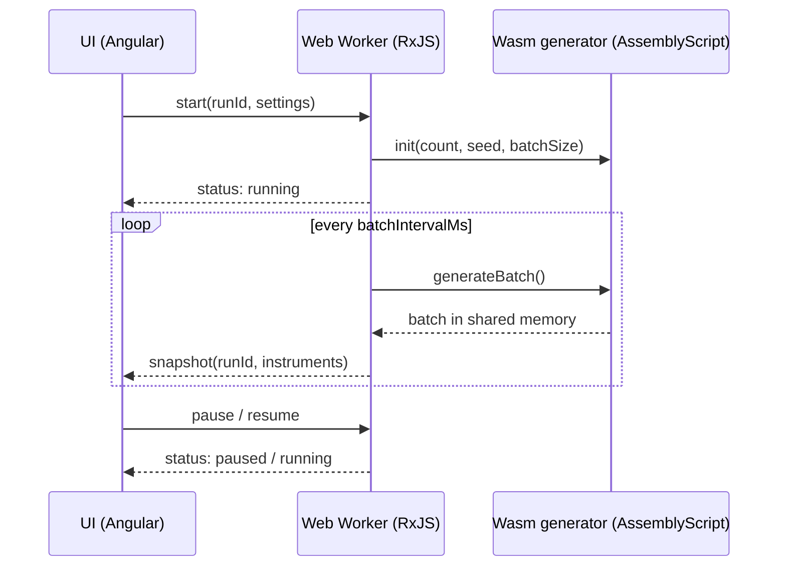

# Realtime Market Dashboard

Angular dashboard for a simulated market feed. A seeded AssemblyScript (Wasm) generator runs in a Web Worker; the worker aggregates trades per instrument and streams snapshots to the UI.

**Demo:** https://ragexe.github.io/realtime-market-dashboard/

## Run

Requires Node 20.19+ / 22.12+.

```bash
npm ci
npm start          # builds Wasm, serves on http://localhost:4200
npm test           # Angular unit tests + Wasm generator tests
npm run build      # production build to dist/
npm run lint
```

## Architecture



- **Wasm generator** (`wasm/assembly`): xoshiro128+ PRNG, random walk per instrument; writes a batch of updates into linear memory, read by the worker through an `Int32Array` view.
- **Worker** (`src/worker`): `createProducer$` turns commands into events: loads the generator, folds each batch into per-instrument totals, emits a snapshot after every batch.
- **UI** (`src/app`): `MarketDataService` holds state (signal + reducer), owns the worker and drops events of stale runs; pages are Dashboard and Settings.
- **Domain** (`src/domain`): framework-free models and pure functions shared by UI and worker. The batch layout enum is shared with AssemblyScript.

## Decisions

- Metrics (last, spread, volume, VWAP, imbalance) are computed from cumulative totals; prices are integer cents, rounded only for display.
- Each Apply starts a new run with a new worker; every event carries a `runId`, so late events of a previous run are ignored.
- Pause stops generation in the worker; resume continues without catching up.
- No snapshot throttling: one snapshot per batch.

## Possible improvements

- Throttle snapshots in the worker (`auditTime`) for high batch rates.
- Virtual scroll and row-level deltas for thousands of instruments.
- Transferable `Float64Array` snapshots instead of object arrays.

## Credits

Favicon by [Icons8](https://icons8.com).
